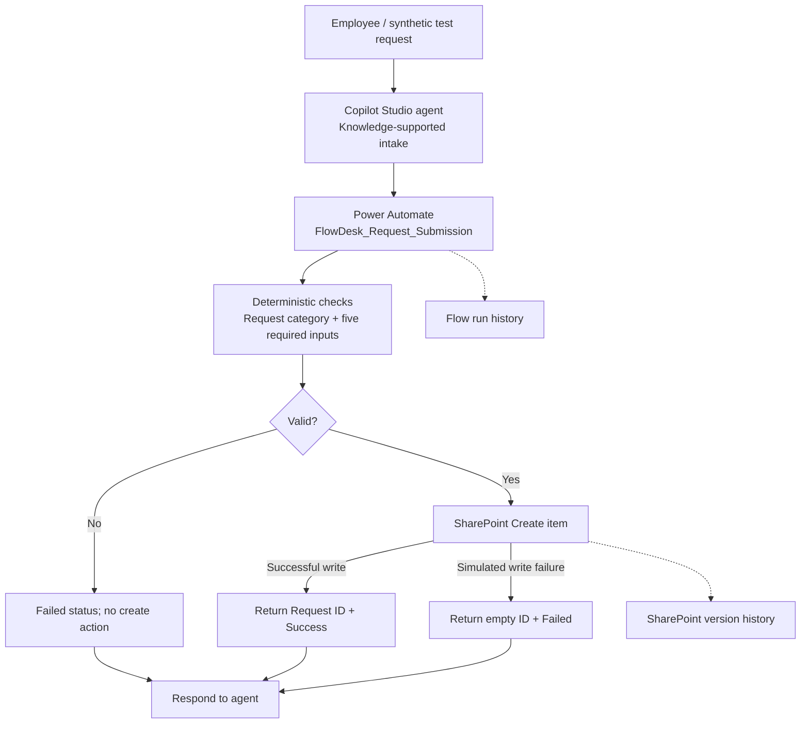

# FlowDesk AI | Governance & Reliability Assessment

**A hands-on AI-assisted service workflow POC with risk-based control testing.**  
Microsoft Copilot Studio · Power Automate · SharePoint  
**Portfolio focus:** AI Governance · Operational Risk · Independent Challenge · Control Validation

> **Decision:** Suitable for continued **single-user, synthetic-data POC** testing. **Not production-ready.** This is an independent learning/portfolio project, not an employer system or an actual production authorization.

## The question

Can an AI-enabled workflow be considered trustworthy simply because it creates tickets successfully? This project combines a conversational intake concept with deterministic backend controls and uses adverse-case testing to investigate what happens when things go wrong.

## System at a glance



*Logical architecture, not a claim that all conversational or exception scenarios are end-to-end validated.* See [architecture notes](architecture/system-architecture.md).

## What was implemented

- Five request fields: requester name, request type, title, description, business impact.
- Supported categories: **IT Support**, **HR Support**, **Operations Support**.
- A deterministic request-type check and a required-field expression; invalid category returns a Failed business status.
- Queue mapping and SharePoint item creation, returning `requestId` and `executionStatus`.
- A controlled static-result fault-injection test for the SharePoint write step.
- Use of SharePoint version history and Power Automate run details as audit evidence.

**AI boundary:** The conversational agent assists with intake and knowledge guidance; downstream routing and validity checks are deterministic. The agent does not authorize HR/IT decisions. This is a workflow-governance POC, **not** a predictive-model validation study.

## Tests and findings

| ID | Scenario | Evidence-based finding | Result |
|---|---|---|---|
| F01–F04 | IT/HR/Operations routing and invalid request type | Functional paths were tested; full dedicated screenshot coverage is incomplete | Passed historically; evidence gaps |
| F05 | Simulated SharePoint failure | Simulated `InternalServerError`; returned empty ID and business status `Failed` | Core test passed |
| F06 | Required-field validation | Complete input validated and SharePoint item **4** created; empty/whitespace cases blocked by test UI | **Partial** |
| G01 | Permissions | List inherits site permissions; sandbox had one user | Assessed; production segregation open |
| G02 | Change history | Status changed `New → In Progress`; SharePoint retained versions **1.0/2.0** | Passed |
| G03 | Run traceability | Create-item response ID **4** reconciled to agent response ID **4** | Core test passed |
| G04 | Repeated submission | Two identical requests generated separate items **5 and 6** | **Gap confirmed** |

### Key finding: technical success ≠ operational correctness

Two duplicate requests both created records successfully. Yet the resulting duplicate workload and inflated reporting would be undesirable if they represented a retry of the same logical request. **Identical text alone is not proof of duplicate business intent**: a reliable remediation needs a submission-level idempotency key, rather than permanently blocking matching text.

### What fault injection taught us

A backend write can fail while the workflow successfully delivers a response. An HTTP 200 on the response action does **not** mean the business transaction succeeded. The user-facing caller must interpret `executionStatus`, not just technical run success.

## Risk-based governance decision

**Continue controlled POC only.** Prior to enterprise deployment, address submission idempotency, multi-user access segregation, negative required-field tests, retry/timeout behavior, durable run-to-record correlation and end-to-end conversational testing. The sandbox risk decision is a **proposed assessment**, not a formally approved corporate risk acceptance.

Read: [Governance Decision Memo](governance/governance-decision-memo.md) · [Risk & Control Matrix](governance/risk-control-matrix.md) · [Production Readiness Gaps](limitations/production-readiness-gaps.md)

## Evidence and reproducibility

- [Test log](testing/test-log.md)
- [Sanitized evidence index](testing/evidence/README.md)
- [Selected screenshot evidence](testing/evidence/)
- [Redacted response examples](testing/redacted-response-examples.json)

All user names in request examples are **synthetic**. Screenshots are edited copies; please perform a final manual privacy inspection before making this repository public. Raw connector outputs, tenant IDs, email addresses, internal URLs, connection credentials and API keys must never be committed.

## Repository layout

```text
architecture/       System diagram and control boundaries
governance/         Governance decision memo; risk and control matrix
testing/            Test log; redacted response examples; evidence screenshots
limitations/        Open findings and production readiness roadmap
```

## Skills demonstrated

Risk identification · Deterministic control design · Fault injection · Operating effectiveness testing · Evidence evaluation · Residual risk assessment · Independent challenge · Production-readiness recommendation.

**Scope note:** Self-directed single-user sandbox; no live employee data; no formal independent certification; no completed multi-user authorization, performance, security or predictive-model testing.
